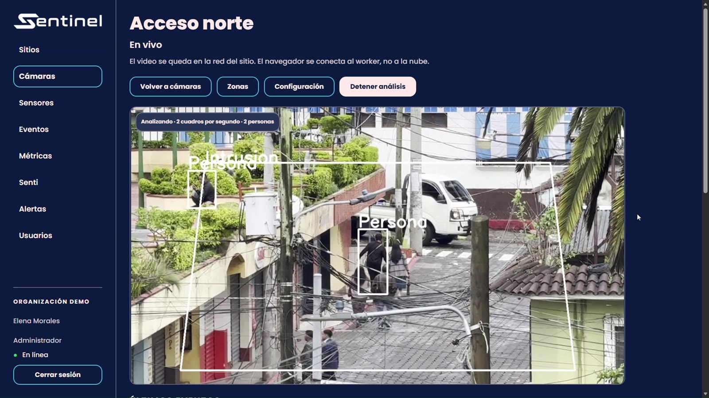
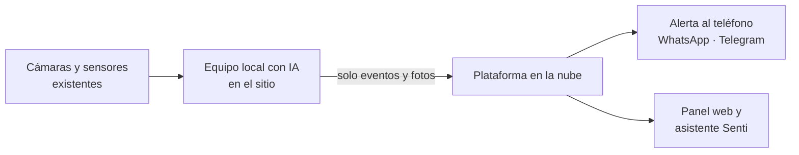

# Sentinel

**Detección de riesgos con inteligencia artificial sobre las cámaras que ya existen.**

Sentinel convierte las cámaras y sensores instalados en empresas y comunidades en un sistema que detecta riesgos y avisa en segundos al responsable, sin reemplazar infraestructura. El video se analiza en el sitio y nunca sale de las instalaciones.

Proyecto desarrollado en Guatemala, dentro del programa ILAN Guatemala.

[Video demo](PEGAR_ENLACE_DEL_VIDEO) · [Pitch](PEGAR_ENLACE_DE_NETLIFY) · [Guía de instalación](docs/SETUP.md)



## El problema

Entrevistamos a 17 monitores de planta en Ciudad de Guatemala:

- 14 de 17 no tienen conexión con una institución de seguridad externa (No hay Vínculo entre el espacio y la gestión rápida de eventos criticos).
- 13 de 17 consideran que tener más pantallas no agiliza el monitoreo.
- 6 monitores en la industria bancaría (Bac, vivibanco), 3 operarios industriales (bebidas centroamericanas,energuate),5 operarios municipales (muni guatemala, muni san lucas), 2 operarios de supermercado (maxi despensa Sumpango), 1 operario de entro comercial.

  Sergio (Operador de vivibanco), menciona que tiene dificultad en seguir un monitoreo constante sobre varias camaras en diferentes puntos durante una jornada de tranajo de cas 8 horas, también menciona que trabajo como monitoreo en el area logistica, donde habian problemas de invasión de áreas y personal no autorizado.  

Las cámaras graban, pero nadie puede mirarlas todo el tiempo. El problema no es la falta de cámaras, sino que la información no llega a quien puede actuar.

## Cómo funciona



1. **Captura.** Se conecta a cámaras IP (RTSP) y a sensores de puerta, movimiento, humo y pánico.
2. **Análisis en el sitio.** Un modelo de visión por computadora detecta y sigue personas varias veces por segundo.
3. **Decisión.** Reglas por zona y horario detectan intrusión, presencia fuera de horario, merodeo y aforo.
4. **Acción.** La plataforma envía la alerta con foto, registra el evento como evidencia y mide el tiempo analizado.

## Funciones del MVP

| Función | Detalle |
| --- | --- |
| Análisis en vivo | Detección de personas en tiempo real, con vista en vivo desde el panel |
| Zonas y reglas | Polígonos dibujados sobre la cámara, horarios y áreas de exclusión |
| Alertas | Aviso inmediato con foto por Telegram y WhatsApp, con enfriamiento para evitar spam |
| Sensores | Puerta, movimiento, humo y botón de pánico en el mismo sistema |
| Eventos | Historial con filtros, evidencia y estados: nuevo, en revisión, resuelto, falso positivo |
| Métricas | Eventos por día, tiempo de respuesta, minutos analizados y costo estimado |
| Senti | Asistente que responde en español qué pasó, con confirmación antes de cualquier cambio |
| Privacidad | El video se procesa en el sitio; a la nube solo viajan eventos e instantáneas |

## Tecnología

| Capa | Tecnología |
| --- | --- |
| Visión por computadora | Python, YOLO (Ultralytics), OpenCV, ByteTrack |
| API | FastAPI, PostgreSQL, Redis, almacenamiento S3 (MinIO) |
| Panel web | Next.js, React, TypeScript |
| Asistente | LLM con llamadas a herramientas seguras (Gemini), sin SQL generado por el modelo |
| Alertas | Telegram Bot API, Twilio WhatsApp |
| Infraestructura | Docker Compose; worker diseñado para correr en un equipo local en el sitio del cliente |

El proyecto incluye 122 pruebas automáticas para la API y el worker.

## Modelo de negocio

- **Implementación:** cobro único por instalar y configurar cámaras y sensores.
- **Pago por uso:** el cliente paga solo por el tiempo que la IA vigila, alrededor de Q0.30 por hora de cámara.

## Probarlo

Todo corre en Docker. Los pasos completos, la configuración de alertas y los datos de demostración están en [docs/SETUP.md](docs/SETUP.md).

```bash
cp .env.example .env
docker compose up -d
```

Luego abre http://localhost:3000.


## Aviso de videovigilancia

El cliente debe contar con base legal para el tratamiento de imágenes y colocar el aviso de videovigilancia correspondiente. Sentinel no extrae el video del sitio y conserva las instantáneas de eventos por 30 días.

© 2026 Equipo Sentinel. Todos los derechos reservados.
